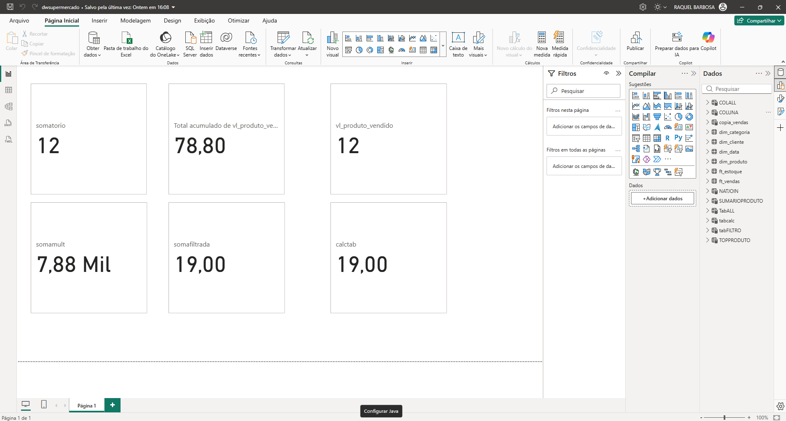
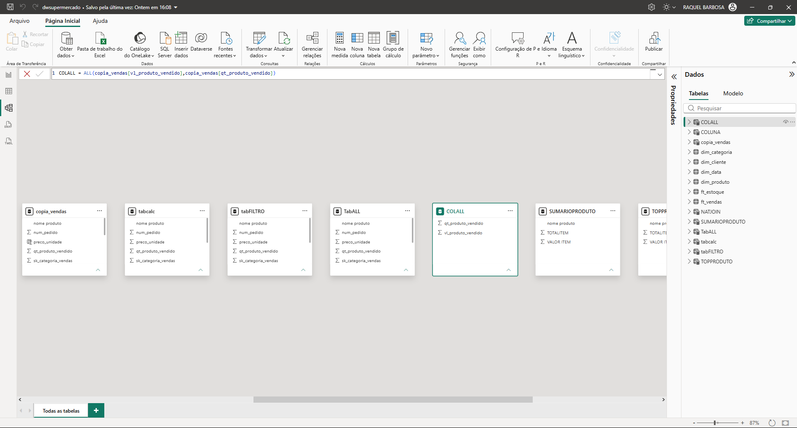
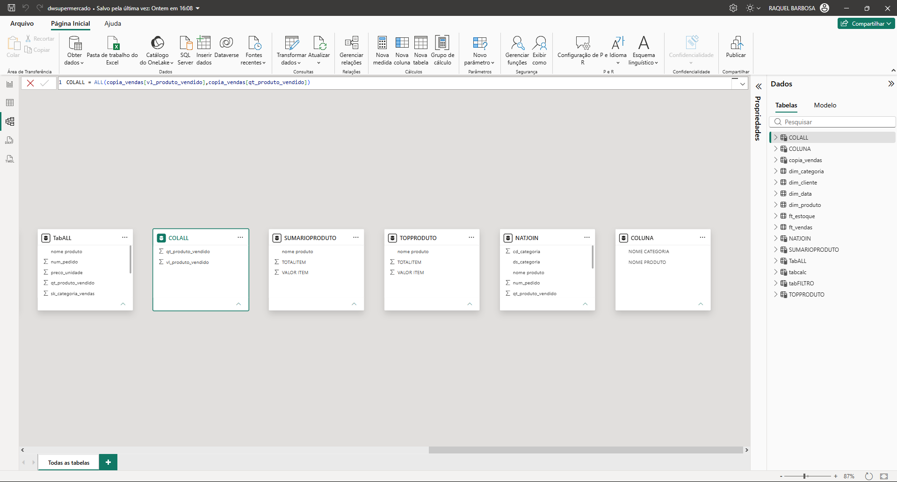

# 📊 Projeto Acadêmico - Modelagem e Cálculos DAX no Power BI

## 📌 Visão Geral
Este projeto foi desenvolvido como parte das atividades acadêmicas da faculdade, com o objetivo de praticar a modelagem de dados relacional, criação de relacionamentos entre tabelas e a aplicação de fórmulas e tabelas calculadas em DAX no Power BI Desktop a partir de um conjunto de dados de supermercado (`dwsupermercado.pbix`).

---

## 📸 Visualizações do Projeto

### 1. Painel de Indicadores e Métricas DAX

### 2. Modelo de Dados e Relacionamentos

### 3. Tabelas Auxiliares e Calculadas (Visão Central)

### 4. Tabelas Auxiliares e Calculadas (Visão Direita)

---

## 🛠️ Conteúdos e Funções Praticadas
* **Modelagem de Dados:** Construção e análise de esquema de dados relacional (tabelas fato e dimensão como `ft_vendas`, `ft_estoque`, `dim_produto`, `dim_cliente`, `dim_data`, `dim_categoria`).
* **Funções DAX:** Criação de medidas e tabelas calculadas utilizando funções como `SUM`, `CALCULATE`, `FILTER`, `SELECTCOLUMNS`, acumulados e junções virtuais.
* **Ferramenta:** Power BI Desktop.
*
